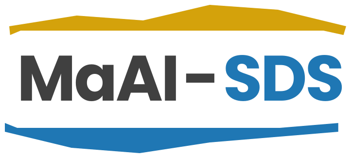
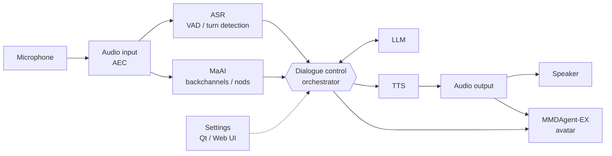
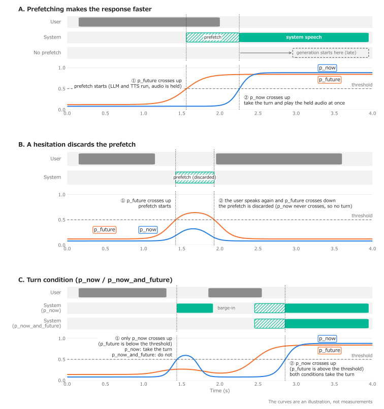

<p align="center">
  <picture>
    <source media="(prefers-color-scheme: dark)" srcset="docs/img/maai-sds-logo-dark.svg">
    
  </picture>
</p>

<p align="center">
  <b>A real-time spoken dialogue system built on MaAI's turn-taking, backchannel and nodding prediction</b>
</p>

<p align="center">
  📄 README: <a href="README.md">English</a> | <a href="README_JP.md">Japanese (日本語)</a>
</p>

<p align="center">
  <a href="LICENSE"></a>
  
  
</p>

---

## Overview

MaAI-SDS is a research platform for real-time spoken dialogue. It connects speech recognition (ASR),
a large language model (LLM) and speech synthesis (TTS) as a pipeline, and uses the VAP (Voice Activity Projection)
models of [MaAI](https://github.com/MaAI-Kyoto/MaAI) to predict turn-taking and to generate backchannels and nods.
The system talks through a 3D avatar in [MMDAgent-EX](https://github.com/mmdagent-ex/MMDAgent-EX).

Each module runs as its own process, and engines can be switched from the settings window. Both local open models
and cloud APIs are supported, so recent ASR and TTS models can be compared within the same dialogue system.

> The source code is released under the [MIT License](LICENSE). The models and libraries it uses are covered by
> their own licenses, some of which are non-commercial only ([THIRD_PARTY_NOTICES.md](THIRD_PARTY_NOTICES.md)).

The supported language is currently Japanese (the dialogue, the user interface and the documents under `docs/`). English support is planned.

## Features

- **Fast turn-taking based on MaAI (VAP)**<br>
  Predicts the end of the user's turn and starts preparing the response in advance
- **Real-time backchannels and nods**<br>
  Gives natural backchannels and nods as a listener
- **Runs entirely locally with low latency**<br>
  Works without sending any audio to the cloud
- **Try a wide range of recent ASR and TTS models**<br>
  Qwen3-ASR, Nemotron, Qwen3-TTS, Irodori-TTS and more (12 ASR and 11 TTS engines). The LLM is selectable too ([Supported engines](#supported-engines))

Also

- Runs as a GUI app (Qt), a Web UI, or with Docker
- Talks to [MMDAgent-EX](https://github.com/mmdagent-ex/MMDAgent-EX)
- MIT-licensed (each model follows its own license)

## Architecture



See [docs/architecture.md](docs/architecture.md) (Japanese) for details.

### Turn-taking

For every frame, MaAI outputs the two probabilities below from the user's and the system's audio. Both are used by whether they
go past the threshold (「MaAIターンしきい値」, the MaAI turn threshold; 0.55 in the example config).

- `p_now`: the probability that the system may start speaking now (short-term prediction)
- `p_future`: the probability that it will be the system's turn a little later (longer-term prediction)

<p align="center">
  <picture>
    <source media="(prefers-color-scheme: dark)" srcset="docs/img/turn-taking-en-dark.svg">
    
  </picture>
</p>

The colors and directions are the same as in the MaAI plot of the settings window: the user side (yellow) is up and the system
side (blue) is down, so a probability grows downwards (closer to the system's turn). The green dashed line is the threshold, and
the hatched bars are prefetches (audio that is generated and held without playing).

- **A. Prefetching makes the response faster**: when `p_future` goes past the threshold shortly before the user finishes, the LLM
  and TTS run before the turn is taken, and the audio is held (①). When `p_now` goes past the threshold, the system takes the
  turn and plays the held audio at once (②). Without prefetching, generation would only start at ②, and the response would be
  late by that much.
- **B. A hesitation discards the prefetch**: a pause in the middle of the user's speech can also make `p_future` go past the
  threshold and start a prefetch (①). When the user keeps talking and `p_future` falls back below the threshold, the prefetch is
  discarded (②). `p_now` never goes past, so the system does not take the turn.
- **C. Turn condition**: chosen with 「ターンを取る条件」 (turn condition). `p_now` takes the turn when `p_now` goes past the
  threshold (①); if the user then keeps talking, the system speech is stopped by barge-in. The default `p_now_and_future` takes
  the turn only if `p_future` is also past the threshold when `p_now` goes past it, so it waits at ① and takes the turn at ②.

Other mechanisms:

- **Frames before taking the turn**: with the default 1, the turn is taken as soon as `p_now` goes past the threshold. A larger value makes the system wait until `p_now` has stayed past the threshold for that many frames, so short pauses in the middle of the user's speech are taken less often (at the cost of that much delay).
- **Turn lock**: after taking the turn, the system does not take the next one until user speech is detected (so it does not keep
  talking on its own).
- **User speech and barge-in**: the user is considered to be speaking when VAD is at or above 「割り込みVADしきい値」 (barge-in
  VAD threshold) and `p_now` is below 「割り込みp_nowしきい値」 (barge-in p_now threshold). If the system is speaking, playback and
  LLM generation stop (backchannels are not stopped). Setting 「割り込む条件」 (barge-in condition) to `p_now_and_future`
  stops it only when `p_future` is also below the same threshold (the default `p_now` looks at `p_now` only).
- **Taking the turn after silence**: if 「ターン取得までの沈黙（秒）」 (silence before taking the turn) passes after the user's
  speech without `p_now` going past the threshold, the system takes the turn.
- **Waiting for the ASR**: with streaming ASR (including pseudo streaming, the default), the LLM is called with the recognition
  result at the moment the turn is taken. Otherwise, the ASR is asked to finalize first.
- **smart-turn**: with `smart-turn` as the turn detector, its probability is used instead of `p_now`. It has no `p_future`, so
  there is no prefetch.
- **Backchannels and nods**: given separately from the turn, from the outputs of MaAI's backchannel and nodding models.

### Run configurations

The dialogue server and the settings window work in four combinations. Audio input/output and the avatar are always
handled on the host.

| Dialogue server | Settings window | Use |
|---|---|---|
| Host (Python) | Qt app | Standard configuration |
| Host (Python) | Web UI | Operate from a browser |
| Docker | Qt app | Keep engine dependencies in a container |
| Docker | Web UI | Run everything, including the settings window, in containers |

Host and Docker can be switched, started and stopped from 「対話サーバー」 (dialogue server) in the header of the settings window.

---

## Requirements

| Item | Requirement |
|---|---|
| OS | Windows (tested on Windows 11; the Qt app, setup scripts and MMDAgent-EX). The dialogue server also runs in Docker (Linux) |
| Python | [3.11](https://www.python.org/downloads/) |
| Package manager | [uv](https://docs.astral.sh/uv/) |
| GPU | An NVIDIA GPU (CUDA 12.8) is recommended. CPU-only setups are also supported |
| Avatar | [MMDAgent-EX](https://github.com/mmdagent-ex/MMDAgent-EX) (Windows build, tested with v2.1) and a CG avatar ([setup](#3-mmdagent-ex-and-the-avatar)) |
| LLM | [LM Studio](https://lmstudio.ai/) with [Gemma 4 E4B](https://lmstudio.ai/models/google/gemma-4-e4b) (`google/gemma-4-e4b`) by default. The OpenAI API and OpenAI-compatible servers also work |
| Optional | [Docker Desktop](https://www.docker.com/products/docker-desktop/), [VOICEVOX](https://voicevox.hiroshiba.jp/), [AivisSpeech](https://aivis-project.com/) |

macOS has not been tested.

---

## Setup

### 1. Environment

`uv sync` alone does not complete the environment (a patched sherpa-onnx and the engine assets are also needed).
The required steps are collected in `scripts/setup_env.ps1`.

```powershell
git clone https://github.com/MaAI-Kyoto/MaAI-SDS.git
cd MaAI-SDS
powershell -ExecutionPolicy Bypass -File scripts\setup_env.ps1              # GPU (default)
powershell -ExecutionPolicy Bypass -File scripts\setup_env.ps1 -Device cpu  # CPU only
```

The script runs, in order: `uv sync` → install the patched sherpa-onnx → fetch the engine assets
(`scripts/setup_assets.ps1`) → verify (sherpa-onnx version, worker start-up, GUI construction, tests).

| Option | Description |
|---|---|
| `-Device cuda` / `cpu` | `cuda` by default (PyTorch cu128 and the CUDA build of ONNX Runtime). `cpu` skips the NVIDIA libraries (about 3.3 GB of `nvidia-*`) and the CUDA build of PyTorch. The choice is recorded in `.device_extra`, and the Engine Manager follows it |
| `-WithNemotron` | Also create `.venv_nemotron` (about 8 GB) for the `nemotron-asr` engine |
| `-SkipAssets` | Do not fetch the engine assets |
| `-SkipSherpa` | Do not install the patched sherpa-onnx (the PyPI build stays, and `nemotron-onnx` becomes less accurate) |
| `-ForceSherpaBuild` | Build sherpa-onnx from source instead of using the prebuilt package (needs Git, CMake and the C++ workload of MSVC Build Tools; [docs/sherpa-onnx-custom-build.md](docs/sherpa-onnx-custom-build.md), Japanese) |
| `-VerifyOnly` | Only verify, without installing anything |

By default, only the assets needed to talk with the default settings (ASR: ReazonSpeech on sherpa-onnx, TTS: VOICEVOX Core)
are fetched. Other engines are installed by selecting them in 「エンジン管理」 (Engine Manager) in the settings window and pressing 「適用」 (Apply).

> [!WARNING]
> Running `uv sync` on its own replaces the patched sherpa-onnx with the PyPI build. Run `scripts\setup_env.ps1`
> again to restore it ([docs/sherpa-onnx-custom-build.md](docs/sherpa-onnx-custom-build.md), Japanese).

### 2. API keys

API keys are passed through environment variables, never written into code or configuration files (see `.env.example`).
The names of the variables to read can be changed in the settings window.

| Use | Environment variable |
|---|---|
| OpenAI (LLM) | `OPENAI_API_KEY` |
| Cartesia (TTS) | `CARTESIA_API_KEY` |

The WebSocket password used to control recording in [OBS Studio](https://obsproject.com/) is entered in 「OBS録画設定」
(OBS recording settings) in the settings window, not through an environment variable. It is stored in `controller_config.json`
(not tracked by Git).

### 3. MMDAgent-EX and the avatar

The avatar is shown with [MMDAgent-EX](https://github.com/mmdagent-ex/MMDAgent-EX) (the official Windows build, v2.1) and its
official sample collection [mmdagent-ex/example](https://github.com/mmdagent-ex/example), which contains the avatars.
Running the following in PowerShell installs MMDAgent-EX in `C:\MMDAgent-EX` and places the MDF and FST for MaAI-SDS inside the
sample collection (replace `<MaAI-SDS folder>` with the folder where you cloned this repository).

```powershell
# 1. MMDAgent-EX itself (MMDAgent-EX-x64-v2.1.zip from Releases). The MMDAgent-EX-x64-v2.1 folder in the ZIP becomes C:\MMDAgent-EX
Invoke-WebRequest https://github.com/mmdagent-ex/MMDAgent-EX/releases/download/v2.1/MMDAgent-EX-x64-v2.1.zip -OutFile $env:TEMP\MMDAgent-EX.zip
Expand-Archive $env:TEMP\MMDAgent-EX.zip -DestinationPath C:\
Rename-Item C:\MMDAgent-EX-x64-v2.1 MMDAgent-EX

# 2. The sample collection. The avatars (Gene and Uka) are submodules, so use --recursive (about 470 MB)
git clone --recursive https://github.com/mmdagent-ex/example C:\MMDAgent-EX\example

# 3. Copy the MDF and FST for MaAI-SDS into the sample collection
Copy-Item -Recurse <MaAI-SDS folder>\assets\mmdagent\maai_sds C:\MMDAgent-EX\example\
```

With this layout, the executable (`C:\MMDAgent-EX\MMDAgent-EX.exe`) and the MDF (`C:\MMDAgent-EX\example\maai_sds\maai_sds.mdf`)
are filled in automatically in 「MMDAgent-EX起動設定」 (MMDAgent-EX launch settings). If you put them elsewhere, set them in
「ファイル設定」 (file settings).

What `maai_sds.mdf` does:

- Connects to the dialogue server over TCP (MMDAgent-EX is the client; the dialogue server listens on `localhost:39001`).
  For WebSocket connections and how to write the MDF, see [docs/running.md](docs/running.md) (Japanese).
- Shows Gene from the sample collection with an upper-body camera in a 1024×1024 window. The idle motion is one with little
  body sway (`01_Wait.vmd`) so that nods are easy to see.
- Lip sync is produced by MMDAgent-EX from the audio it receives; nods (neck), gaze and blinks are sent by MaAI-SDS. Because the
  neck is used for nodding, the neck movement of the idle motion stops.

> [!NOTE]
> This repository does not include MMDAgent-EX, the avatars or the motions (get them from their distributors with the steps above).
> The bundled `maai_sds.mdf` / `maai_sds.fst` only contain settings that refer to those files by name.
>
> - **Gene** (`gene/`) is released under CC BY 4.0. When you publish videos or presentations showing Gene, include the credit below.
>   Nagoya Institute of Technology holds the trademark and design rights: academic use (papers, presentations, etc.) and personal
>   non-commercial use need no permission, but other commercial use requires separate permission (see the license section of
>   [mmdagent-ex/gene](https://github.com/mmdagent-ex/gene)).
>
>   ```text
>   CG-CA Gene (c) 2023 by Nagoya Institute of Technology, Moonshot R&D Goal 1 Avatar Symbiotic Society
>   ```
>
> - **The motions and images of the sample collection** (the idle motion `motions/wait/01_Wait.vmd` and the backgrounds
>   `images/floor_block.png` and `images/back_white.png` used by `maai_sds.fst`, among others) have no stated license. Check with the
>   distributor ([mmdagent-ex/example](https://github.com/mmdagent-ex/example)) before publishing videos that show them.

### 4. External applications

| Application | Preparation |
|---|---|
| [LM Studio](https://lmstudio.ai/) (default LLM) | Download [Gemma 4 E4B](https://lmstudio.ai/models/google/gemma-4-e4b) (`lms get google/gemma-4-e4b`) and start the local server (the model can be changed in the settings) |
| [VOICEVOX](https://voicevox.hiroshiba.jp/) / [AivisSpeech](https://aivis-project.com/) | Install and start each engine |
| OpenAI-compatible server | Expose an API with [vLLM](https://github.com/vllm-project/vllm) or similar (LLM backend "Custom") |
| Qwen3-ASR | [Docker Desktop](https://www.docker.com/products/docker-desktop/) and an NVIDIA GPU. The settings window starts the container automatically when the ASR starts |

---

## Running

### Qt app

```powershell
.venv\Scripts\python main.py
```

Configure ASR, LLM, TTS, MaAI and MMDAgent-EX in the settings window and start the dialogue. On first launch,
`controller_config.json` (not tracked by Git) is created from `controller_config.example.json`.

> [!IMPORTANT]
> Do not use `uv run python main.py`. It syncs the environment without extras, which removes PySide6 and replaces PyTorch
> with the CPU build. To launch through uv, use `uv run --no-sync python main.py`.

### Web UI

```powershell
.venv\Scripts\python -m maai_sds.web.server
```

Open <http://127.0.0.1:8000/> (configurable with `MAAI_SDS_WEB_HOST` and `MAAI_SDS_WEB_PORT`).
See [docs/running.md](docs/running.md) (Japanese) for the steps.

### Docker

```powershell
copy controller_config.docker.example.json controller_config.docker.json   # first time only
copy .env.example .env                                                     # fill in the location of the MMDAgent-EX assets, etc.
if (-not (Test-Path enabled_engines.json)) { Set-Content enabled_engines.json "[]" }  # first time only
docker compose -f docker-compose.yml -f docker-compose.gpu.yml up -d       # GPU (Web UI)
docker compose -f docker-compose.yml -f docker-compose.cpu.yml up -d       # CPU (Web UI)
```

- **Web UI**: <http://127.0.0.1:8000/> ([docs/running.md](docs/running.md), Japanese)
- **Qt app**: start with `scripts\start_qt_docker.ps1` ([docs/running.md](docs/running.md), Japanese).
  The compose services `web` and `orchestrator` use the same ports, so do not run them at the same time
- **Additional services**: started only with `--profile qwen3`, `--profile nemotron` or `--profile audiocpp`
- **Qwen3-ASR**: runs as the compose service `qwen3-asr` (GPU only). The Qt app and the host Web UI start and stop it together
  with the ASR. To use it from the Web UI inside compose, start with `--profile qwen3` from the beginning. The first start takes a
  few minutes to fetch the image and the model

Only one settings window can be connected to the dialogue server in Docker at a time.

---

## Supported engines

In the settings window, the engine lists show one "model (runtime)" combination per row (for example, Haas-ja v1.0 (speech.cpp)).
The left column of the tables below is the value stored in the configuration file.

Speed, accuracy and memory comparisons of Japanese ASR, TTS and LLMs, measured per runtime, are collected in
[Awesome Japanese Spoken Dialogue Stack](https://github.com/kazu44ttaka/awesome-japanese-spoken-dialogue-stack).

### ASR (speech recognition)

| Engine | Runs on | Notes |
|---|---|---|
| `sherpa-onnx` | Local ([sherpa-onnx](https://github.com/k2-fsa/sherpa-onnx)) | [ReazonSpeech k2-v2](https://huggingface.co/reazon-research/reazonspeech-k2-v2). Default |
| `speechcpp-asr` | Local ([speech.cpp](https://github.com/nyosegawa/speech.cpp)) | [Haas-ja v1.0](https://huggingface.co/third-intelligence/Haas-ja-v1.0), [ReazonSpeech NeMo v2](https://huggingface.co/reazon-research/reazonspeech-nemo-v2), [Parakeet TDT-CTC 0.6B ja](https://huggingface.co/nvidia/parakeet-tdt_ctc-0.6b-ja), [Qwen3-ASR 1.7B](https://huggingface.co/Qwen/Qwen3-ASR-1.7B). Haas-ja takes about 30 ms per utterance on a GPU with 0.8 GB of GPU memory. Uses Vulkan on Windows and CUDA in the Docker GPU image |
| `sensevoice-onnx` | Local (sherpa-onnx) | [SenseVoiceSmall](https://huggingface.co/FunAudioLLM/SenseVoiceSmall) |
| `parakeet-onnx` | Local (sherpa-onnx) | [Parakeet TDT-CTC 0.6B Japanese](https://huggingface.co/nvidia/parakeet-tdt_ctc-0.6b-ja) |
| `cohere-asr-onnx` | Local (sherpa-onnx) | [Cohere Transcribe](https://huggingface.co/CohereLabs/cohere-transcribe-03-2026) (14 languages) |
| `funasr-nano-onnx` | Local (sherpa-onnx) | [Fun-ASR-Nano-2512](https://huggingface.co/FunAudioLLM/Fun-ASR-Nano-2512) |
| `qwen3-asr-onnx` | Local (sherpa-onnx) | [Qwen3-ASR 0.6B](https://huggingface.co/Qwen/Qwen3-ASR-0.6B) |
| `nemotron-onnx` | Local (patched sherpa-onnx) | [Nemotron 3.5 streaming](https://huggingface.co/nvidia/nemotron-3.5-asr-streaming-0.6b). True streaming recognition |
| `faster-whisper` | Local ([faster-whisper](https://github.com/SYSTRAN/faster-whisper)) | Whisper models |
| `qwen3-asr` | Docker ([`qwenllm/qwen3-asr`](https://hub.docker.com/r/qwenllm/qwen3-asr)) | [Qwen3-ASR](https://github.com/QwenLM/Qwen3-ASR) (vLLM). The container starts and stops with the ASR |
| `nemotron-asr` | Dedicated environment ([NeMo](https://github.com/NVIDIA/NeMo)) | Create `.venv_nemotron` from the Engine Manager or with `setup_env.ps1 -WithNemotron` |
| `external-asr-tcp` | External | Connects to an external ASR over TCP |

Voice activity detection can be `maai` or [`silero`](https://github.com/snakers4/silero-vad), and turn detection `maai` or
[`smart-turn`](https://github.com/pipecat-ai/smart-turn) (the default settings use `silero` and `maai`).
Measurements of each engine and the reasoning behind the defaults are in [docs/asr-engine-notes.md](docs/asr-engine-notes.md) (Japanese).

### TTS (speech synthesis)

| Engine | Runs on | Notes |
|---|---|---|
| `VOICEVOX-Core` | Local ([voicevox_core](https://github.com/VOICEVOX/voicevox_core)) | Default. GPU supported |
| `VOICEVOX` | HTTP | The [VOICEVOX](https://voicevox.hiroshiba.jp/) engine |
| `AivisSpeech` | HTTP | The [AivisSpeech](https://aivis-project.com/) engine |
| `Irodori-v4` | Local (speech.cpp / audio.cpp / PyTorch) | [Irodori-TTS](https://github.com/Aratako/Irodori-TTS). speech.cpp by default ([v4.1 Small MF](https://huggingface.co/Aratako/Irodori-TTS-v4.1-Small-MF), 0.15–0.3 s per sentence on a GPU). Can also use audio.cpp (500M v3 / 600M v3 VoiceDesign, reading CER 0.004) or PyTorch (dedicated environment) |
| `Qwen3-TTS-CPP` | Local ([audio.cpp](https://github.com/0xShug0/audio.cpp)) | [Qwen3-TTS 1.7B CustomVoice](https://huggingface.co/Qwen/Qwen3-TTS-12Hz-1.7B-CustomVoice) (GGUF). About 70 ms to the first audio (streaming) |
| `LFM2.5-Audio` | Local (audio.cpp) | [LFM2.5-Audio-1.5B-JP](https://huggingface.co/LiquidAI/LFM2.5-Audio-1.5B-JP). About 0.33 s per sentence and about 50 ms to the first audio (streaming). One voice. LFM Open License v1.0 (commercial use allowed below USD 10 million in annual revenue) |
| `Supertonic-3` | Local (audio.cpp) | [Supertonic 3](https://huggingface.co/Supertone/supertonic-3) |
| `Kokoro-RealtimeTTS` | Local ([RealtimeTTS](https://github.com/KoljaB/RealtimeTTS)) | [Kokoro-82M](https://huggingface.co/hexgrad/Kokoro-82M) |
| `Tsukasa` | Local (PyTorch) | [Tsukasa Speech](https://huggingface.co/Respair/Tsukasa_Speech). Non-commercial license |
| `Cartesia-Realtime` | Cloud ([Cartesia](https://cartesia.ai/)) | Requires an API key |
| `TEMPLATE` | HTTP | Any TTS API, described with a JSON template |

`Irodori-v4`, `Qwen3-TTS-CPP` and `LFM2.5-Audio` (as well as `Kokoro-RealtimeTTS` and `Cartesia-Realtime`) start playing audio before
a sentence is fully synthesized (streaming). MMDAgent-EX produces the avatar's mouth movement from the audio it receives, over either
TCP or WebSocket, so lip sync stays in time with streamed audio.

### LLM

[LM Studio](https://lmstudio.ai/) (default), [OpenAI](https://platform.openai.com/) and Custom (OpenAI-compatible APIs) are supported.
The default models are [Gemma 4 E4B](https://huggingface.co/google/gemma-4-E4B-it) (`google/gemma-4-e4b`) for LM Studio and
`gpt-5-nano` for OpenAI.

---

## Documentation (Japanese)

| Document | Contents |
|---|---|
| [docs/running.md](docs/running.md) | Start-up steps, checks and troubleshooting for each run configuration |
| [docs/architecture.md](docs/architecture.md) | Processes, launch modes (including the headless CLI), inter-process communication and data flow |
| [docs/internals.md](docs/internals.md) | Internals of each module (dialogue control, audio I/O, ASR, MaAI, LLM, TTS, MMDAgent-EX, settings window) |
| [docs/asr-engine-notes.md](docs/asr-engine-notes.md) | Measurements of the ASR engines and the reasoning behind the defaults |
| [docs/sherpa-onnx-custom-build.md](docs/sherpa-onnx-custom-build.md) | The sherpa-onnx patches and how to build them |
| [docs/ui-guidelines.md](docs/ui-guidelines.md) | UI design principles and wording rules |

## Repository layout

```
main.py                    Entry point of the Qt app (the code is in src/maai_sds/main.py)
src/maai_sds/
  gui/                     Qt app (controller.py: control, ui.py: building the screens)
  web/                     Web UI server
  dialog/                  Dialogue server (orchestrator.py: dialogue state machine)
  asr/ llm/ tts/           Engines and workers
  audio/                   Audio input/output and sending audio to the avatar
  maai/                    MaAI (turn-taking, backchannels, nods)
  mmd/                     MMDAgent-EX integration
  obs/                     OBS recording control
  ipc/                     Process management and JSON Lines communication
web/app/                   Web UI front end
scripts/                   Setup, launch and build scripts
docker/ Dockerfile docker-compose*.yml
assets/                    Small bundled assets (Nemotron preprocessor ONNX)
docs/                      Design documents (Japanese)
tests/                     Tests
```

Workers are started as `python -m maai_sds.<subpackage>.<name>` (for example `maai_sds.asr.worker`).
Configuration files, `maai_assets/`, `logs/` and models given as relative paths are resolved from the repository root (`src/maai_sds/paths.py`).

## Tests

```powershell
.venv\Scripts\python -B -m unittest discover -s tests -p "test_*.py"
```

`-B` prevents stale bytecode (`.pyc`) from being reused. CPython decides whether a `.pyc` is fresh from the source file's
modification time (in seconds) and size, so an edit of the same size within the same second can leave an old `.pyc` in use.

---

## Acknowledgements

MaAI-SDS uses the projects below. Follow each project's license and terms (model redistribution, credit requirements,
conditions for commercial use, etc.). Details are in [THIRD_PARTY_NOTICES.md](THIRD_PARTY_NOTICES.md).

- [MaAI](https://github.com/MaAI-Kyoto/MaAI) — turn-taking, backchannels and nods with VAP
- [MMDAgent-EX](https://github.com/mmdagent-ex/MMDAgent-EX) — avatar
- ASR: [sherpa-onnx](https://github.com/k2-fsa/sherpa-onnx), [speech.cpp](https://github.com/nyosegawa/speech.cpp), [ReazonSpeech](https://github.com/reazon-research/ReazonSpeech), [Haas-ja](https://huggingface.co/third-intelligence/Haas-ja-v1.0), [faster-whisper](https://github.com/SYSTRAN/faster-whisper), [Qwen3-ASR](https://github.com/QwenLM/Qwen3-ASR), [NVIDIA NeMo](https://github.com/NVIDIA/NeMo) (Nemotron), [silero-vad](https://github.com/snakers4/silero-vad), [smart-turn](https://github.com/pipecat-ai/smart-turn)
- TTS: [VOICEVOX](https://voicevox.hiroshiba.jp/) / [VOICEVOX Core](https://github.com/VOICEVOX/voicevox_core), [AivisSpeech](https://aivis-project.com/), [Irodori-TTS](https://github.com/Aratako/Irodori-TTS), [Kokoro](https://huggingface.co/hexgrad/Kokoro-82M) / [RealtimeTTS](https://github.com/KoljaB/RealtimeTTS), [Qwen3-TTS](https://github.com/QwenLM/Qwen3-TTS), [LFM2.5-Audio](https://huggingface.co/LiquidAI/LFM2.5-Audio-1.5B-JP), [audio.cpp](https://github.com/0xShug0/audio.cpp), [Supertonic](https://github.com/supertone-inc/supertonic), [Tsukasa Speech](https://huggingface.co/Respair/Tsukasa_Speech), [Cartesia](https://cartesia.ai/)
- LLM: [LM Studio](https://lmstudio.ai/), [Gemma 4](https://huggingface.co/google/gemma-4-E4B-it)

## License

The source code is released under the [MIT License](LICENSE) (Copyright (c) 2026 Kazushi Kato).
For the licenses of third-party software and models, see [THIRD_PARTY_NOTICES.md](THIRD_PARTY_NOTICES.md).
