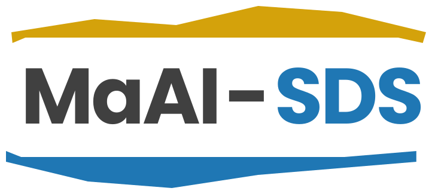
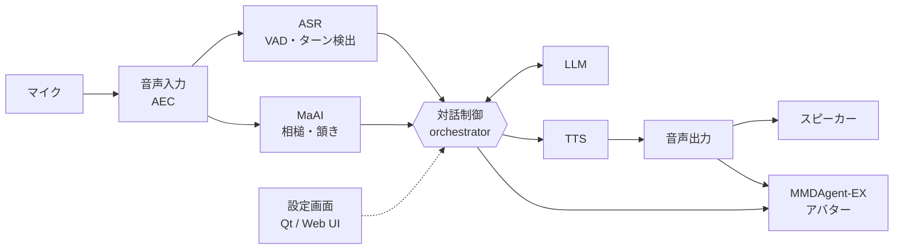
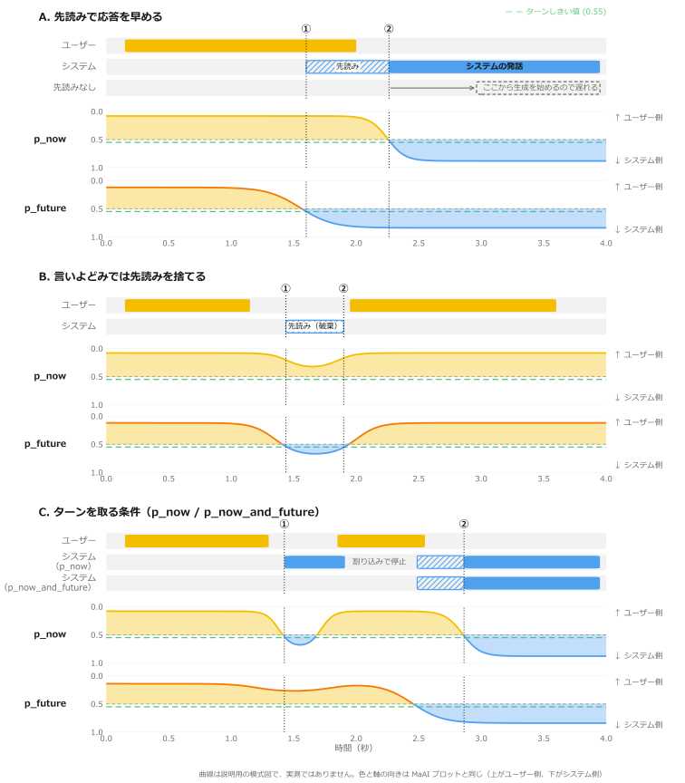

<p align="center">
  <picture>
    <source media="(prefers-color-scheme: dark)" srcset="docs/img/maai-sds-logo-dark.svg">
    
  </picture>
</p>

<p align="center">
  <b>MaAIによるターンテイキング・相槌・頷きに基づくリアルタイム音声対話システム</b>
</p>

<p align="center">
  📄 README: <a href="README.md">English</a> | <a href="README_JP.md">Japanese (日本語)</a>
</p>

<p align="center">
  <a href="LICENSE"></a>
  
  
</p>

---

## 概要

MaAI-SDS は、音声対話をリアルタイムに行うための研究用プラットフォームです。音声認識（ASR）・
大規模言語モデル（LLM）・音声合成（TTS）をパイプラインとして接続し、[MaAI](https://github.com/MaAI-Kyoto/MaAI) の
VAP（Voice Activity Projection）モデルによるターンテイキング予測・相槌生成・頷き生成を組み合わせて、
[MMDAgent-EX](https://github.com/mmdagent-ex/MMDAgent-EX) の 3D アバターを駆動します。

各モジュールは独立したプロセスとして動作し、エンジンは設定画面から切り替えられます。ローカルの
オープンモデルとクラウド API の双方に対応しており、最新の ASR・TTS モデルを同じ対話系の上で比較できます。

現在は日本語に対応しています（対話・画面・`docs/` の文書）。英語にも対応する予定です。

> 本体のソースコードは [MIT ライセンス](LICENSE) で公開しています。利用するモデル・ライブラリにはそれぞれの
> ライセンスが適用され、非商用に限られるものも含まれます（[THIRD_PARTY_NOTICES.md](THIRD_PARTY_NOTICES.md)）。

## 特徴

- **MaAI（VAP）に基づく素早いターンテイキング**<br>
  発話終了を予測し、あらかじめ応答を生成
- **相槌・頷きをリアルタイムに生成**<br>
  聞き手として自然な相槌、頷きを生成
- **すべてローカルで動き、低遅延で応答**<br>
  クラウドに音声を送らずに動かせる
- **最新の ASR・TTS モデルを幅広く試せる**<br>
  Qwen3-ASR・Nemotron・Qwen3-TTS・Irodori-TTS など（ASR 12 種・TTS 11 種）。LLM も選べる（[対応エンジン](#対応エンジン)）

そのほか

- GUI アプリ（Qt）／ Web UI ／ Docker で動作
- [MMDAgent-EX](https://github.com/mmdagent-ex/MMDAgent-EX) と通信可能
- 本体は MIT ライセンス（各モデルはそれぞれのライセンスに従う）

## システム構成



詳細は [docs/architecture.md](docs/architecture.md) を参照してください。

### ターンテイキングの仕組み

MaAI はユーザーとシステムの音声から、フレームごとに次の 2 つの確率を出します。どちらも、しきい値
（「MaAIターンしきい値」。見本の設定では 0.55）を超えたかどうかで使います。

- `p_now`：システムが今すぐ話し始めてよい確率（短い先の予測）
- `p_future`：もう少し先でシステムの番になる確率（長い先の予測）

<p align="center">
  <picture>
    <source media="(prefers-color-scheme: dark)" srcset="docs/img/turn-taking-ja-dark.svg">
    
  </picture>
</p>

図の色と向きは、設定画面の MaAI プロットと同じです。上がユーザー側（黄）、下がシステム側（青）で、確率は下に行くほど
大きく（システムの番に近く）なります。緑の破線がしきい値、斜線の帯が先読み（音声を作り、再生せずに保持している区間）です。

- **A. 先読みで応答を早める**：ユーザーが話し終わる少し前に `p_future` がしきい値を超えると、ターンを取る前に LLM と
  TTS を動かし、音声を保持します（①）。`p_now` がしきい値を超えたらターンを取り、保持した音声をすぐ流します（②）。
  先読みしない場合は②から生成を始めるので、その分だけ応答が遅れます。
- **B. 言いよどみでは先読みを捨てる**：話の途中の間でも `p_future` が超えて、先読みが始まります（①）。ユーザーが
  話し続けて `p_future` がしきい値を下回ったら、先読みを捨てます（②）。`p_now` は超えないので、ターンは取りません。
- **C. ターンを取る条件**：「ターンを取る条件」で選びます。`p_now` は、`p_now` が超えたらターンを取ります（①）。
  そのあとユーザーが話を続けると、割り込みでシステムの発話が止まります。既定の `p_now_and_future` は、`p_now` が
  超えた時点で `p_future` もしきい値以上のときだけ取るので、①では取らずに②で取ります。

それ以外の仕組み：

- **ターンを取るまでの連続フレーム数**：既定の 1 はしきい値を超えた時点で取る。増やすと、`p_now` が何フレーム続けて超えたら取るかになり、相手の話の途中の短い間で取りにくくなる（その分だけ遅れる）。
- **ターンロック**：ターンを取ったあとは、ユーザーの発話を検出するまで次のターンを取らない（システムが続けて話さないため）。
- **ユーザーの発話の検出と割り込み**：VAD が「割り込みVADしきい値」以上で、`p_now` が「割り込みp_nowしきい値」未満なら、
  ユーザーが話していると見なす。システムの発話中なら、再生と LLM の生成を止める（相槌は止めない）。
  「割り込む条件」を `p_now_and_future` にすると、`p_future` も同じしきい値未満のときだけ止める（既定は `p_now` だけで見る）。
- **沈黙後のターン取得**：ユーザーの発話のあと、`p_now` が超えないまま「ターン取得までの沈黙（秒）」が過ぎたら、ターンを取る。
- **ASR を待つか**：ストリーミングの ASR（疑似ストリーミングを含む。既定）では、ターンを取った時点の認識結果で LLM を呼ぶ。
  そうでなければ、ASR に認識を確定させてから呼ぶ。
- **smart-turn**：ターン検出を `smart-turn` にすると、`p_now` の代わりにその確率を使う。`p_future` が無いので先読みはしない。
- **相槌・頷き**：ターンとは別に、MaAI の相槌・頷きのモデルの出力から出す。

### 実行構成

対話サーバーと設定画面は、次の 4 通りの組み合わせで動作します。音声入出力とアバターは、いずれの構成でもホストで扱います。

| 対話サーバー | 設定画面 | 用途 |
|---|---|---|
| ホスト（Python） | Qt アプリ | 標準の構成 |
| ホスト（Python） | Web UI | ブラウザからの操作 |
| Docker | Qt アプリ | エンジンの依存関係をコンテナに分離 |
| Docker | Web UI | 設定画面を含めてコンテナで実行 |

ホストと Docker は、設定画面のヘッダーにある「対話サーバー」から切り替え・起動・停止できます。

---

## 動作環境

| 項目 | 要件 |
|---|---|
| OS | Windows（Windows 11 で確認。Qt アプリ・セットアップスクリプト・MMDAgent-EX）。対話サーバーは Docker（Linux）でも動作 |
| Python | [3.11](https://www.python.org/downloads/)（python.org の公式版を推奨。sherpa-onnx のビルド済みパッケージが 3.11 向けのため、`.python-version` で 3.11 を指定） |
| ビルドツール | [Visual Studio 2022 Build Tools](https://visualstudio.microsoft.com/visual-cpp-build-tools/)（C++ によるデスクトップ開発）と [CMake](https://cmake.org/)。pyopenjtalk などをソースからビルドするため |
| パッケージ管理 | [uv](https://docs.astral.sh/uv/) |
| GPU | NVIDIA GPU（CUDA 12.8）を推奨。CPU のみの構成にも対応 |
| アバター | [MMDAgent-EX](https://github.com/mmdagent-ex/MMDAgent-EX)（Windows 版。v2.1 で確認）と CG アバター（[セットアップ](#3-mmdagent-ex-とアバター)） |
| LLM | 既定は [LM Studio](https://lmstudio.ai/) と [Gemma 4 E4B](https://lmstudio.ai/models/google/gemma-4-e4b)（`google/gemma-4-e4b`）。OpenAI API・OpenAI 互換サーバーも利用可 |
| その他（任意） | [Node.js](https://nodejs.org/)（一部のテストで使用）、[Docker Desktop](https://www.docker.com/products/docker-desktop/)、[VOICEVOX](https://voicevox.hiroshiba.jp/)、[AivisSpeech](https://aivis-project.com/) |

macOS での動作は確認していません。

---

## セットアップ

### 1. 環境構築

`uv sync` だけでは環境は完成しません（パッチを当てた sherpa-onnx とエンジンの資産が別途必要）。
必要な手順は `scripts/setup_env.ps1` にまとめてあります。

```powershell
git clone https://github.com/MaAI-Kyoto/MaAI-SDS.git
cd MaAI-SDS
powershell -ExecutionPolicy Bypass -File scripts\setup_env.ps1              # GPU 構成（既定）
powershell -ExecutionPolicy Bypass -File scripts\setup_env.ps1 -Device cpu  # CPU 構成
```

スクリプトは次の順に実行します：`uv sync` → パッチ適用済み sherpa-onnx の導入 → エンジン資産の取得
（`scripts/setup_assets.ps1`）→ 検証（sherpa-onnx の版・ワーカーの起動・GUI の構築・テスト）。
最初に前提（スマート アプリ コントロール・MSVC・CMake・Python 3.11・Node.js）を確認し、MSVC の環境を読み込むので、
Developer PowerShell から実行する必要はありません。

| オプション | 説明 |
|---|---|
| `-Device cuda` / `cpu` | 既定は `cuda`（PyTorch cu128・CUDA 版 ONNX Runtime）。`cpu` では NVIDIA のライブラリ（`nvidia-*` で約 3.3 GB）と CUDA 版 PyTorch を導入しない。選択は `.device_extra` に記録され、エンジン管理もこれに従う |
| `-WithNemotron` | `nemotron-asr` 用の環境 `.venv_nemotron`（約 8 GB）も作成する |
| `-SkipAssets` | エンジン資産を取得しない |
| `-SkipSherpa` | パッチ適用済み sherpa-onnx を導入しない（PyPI 版のままになり、`nemotron-onnx` の精度が下がる） |
| `-ForceSherpaBuild` | ビルド済みの sherpa-onnx を使わず、ソースからビルドする（Git・CMake・MSVC Build Tools の C++ が必要。[docs/sherpa-onnx-custom-build.md](docs/sherpa-onnx-custom-build.md)） |
| `-InstallPrereqs` | 足りない前提（VS 2022 Build Tools の C++・CMake・Python 3.11・Node.js）を winget で導入する。Build Tools は数 GB で、管理者の確認が出る。既定では導入せず、足りないものと導入方法を表示する |
| `-VerifyOnly` | 導入せず検証のみ行う |

既定で取得するのは、既定の設定（ASR：ReazonSpeech〔sherpa-onnx〕、TTS：VOICEVOX Core）で対話できる最小限の資産です。
その他のエンジンは、設定画面の「エンジン管理」で選択して「適用」すると導入されます。

> [!WARNING]
> `uv sync` を単独で実行すると、パッチ適用済みの sherpa-onnx が PyPI 版で上書きされます。その場合は
> `scripts\setup_env.ps1` を再実行して復元してください（[docs/sherpa-onnx-custom-build.md](docs/sherpa-onnx-custom-build.md)）。

> [!NOTE]
> Windows でうまくいかないとき：
>
> - **スマート アプリ コントロール**がオンだと、署名の無い Python や拡張モジュールが止められ、`uv sync` が失敗します
>   （`os error 4551`、`DLL load failed`）。Windows セキュリティでオフにしてください（`setup_env.ps1` も確認します）。
> - ビルドに失敗したあとで MSVC や CMake を入れた場合は、失敗したときのビルド設定が uv のキャッシュに残っています。
>   `uv cache clean <パッケージ名>`（例：`uv cache clean pyopenjtalk`）で消してから再実行してください。
>   それでも失敗するときは、Developer PowerShell for VS 2022 から実行してみてください。

### 2. API キー

API キーはコードや設定ファイルに書かず、環境変数で渡します（`.env.example` 参照）。読む環境変数の名前は設定画面で変えられます。

| 用途 | 環境変数 |
|---|---|
| OpenAI（LLM） | `OPENAI_API_KEY` |
| Cartesia（TTS） | `CARTESIA_API_KEY` |

[OBS Studio](https://obsproject.com/) の録画操作に使う WebSocket のパスワードは、環境変数ではなく設定画面の「OBS録画設定」で入力します。
入力した値は `controller_config.json`（Git 管理外）に保存されます。

### 3. MMDAgent-EX とアバター

アバターの表示には [MMDAgent-EX](https://github.com/mmdagent-ex/MMDAgent-EX)（公式の Windows 版 v2.1）と、
アバターの入った公式のサンプル集 [mmdagent-ex/example](https://github.com/mmdagent-ex/example) を使います。
PowerShell で次を実行すると、MMDAgent-EX が `C:\MMDAgent-EX` に入り、MaAI-SDS 用の MDF と FST がサンプル集の中に置かれます
（`<MaAI-SDS のフォルダー>` は、このリポジトリを clone した場所に置き換えます）。

```powershell
# 1. 本体（Releases の MMDAgent-EX-x64-v2.1.zip）。ZIP の中の MMDAgent-EX-x64-v2.1 フォルダーを C:\MMDAgent-EX にする
Invoke-WebRequest https://github.com/mmdagent-ex/MMDAgent-EX/releases/download/v2.1/MMDAgent-EX-x64-v2.1.zip -OutFile $env:TEMP\MMDAgent-EX.zip
Expand-Archive $env:TEMP\MMDAgent-EX.zip -DestinationPath C:\
Rename-Item C:\MMDAgent-EX-x64-v2.1 MMDAgent-EX

# 2. サンプル集。アバター（ジェネ・ウカ）はサブモジュールなので --recursive を付ける（約 470 MB）
git clone --recursive https://github.com/mmdagent-ex/example C:\MMDAgent-EX\example

# 3. MaAI-SDS 用の MDF と FST をサンプル集の中へコピーする
Copy-Item -Recurse <MaAI-SDS のフォルダー>\assets\mmdagent\maai_sds C:\MMDAgent-EX\example\
```

この配置にすると、設定画面の「MMDAgent-EX起動設定」に、実行ファイル（`C:\MMDAgent-EX\MMDAgent-EX.exe`）と MDF
（`C:\MMDAgent-EX\example\maai_sds\maai_sds.mdf`）が自動で入ります。別の場所に置いた場合は「ファイル設定」で指定してください。

`maai_sds.mdf` の内容：

- 対話サーバーへ TCP で接続します（MMDAgent-EX がクライアントになり、対話サーバーが `localhost:39001` で待ち受けます）。
  WebSocket で接続する場合や MDF の書き方は [docs/running.md](docs/running.md) を参照してください。
- サンプル集のジェネを、上半身のカメラ・1024×1024 のウィンドウで表示します。待機モーションは、頷きが見やすいように
  体の揺れが小さいもの（`01_Wait.vmd`）にしてあります。
- 口パクは MMDAgent-EX が受け取った音声から作り、頷き（首）・視線・まばたきは MaAI-SDS が送ります。首を頷きに使うため、
  待機モーションの首の動きは止まります。

**ブラウザに表示する場合**：MMDAgent-EX 本体の代わりに、ブラウザ版の [MMDAgent-EX Web](https://github.com/kazu44ttaka/mmdagent-ex-web)
でアバターを表示できます。本体（上の手順 1）は要らず、サンプル集と `maai_sds` フォルダー（手順 2・3）だけを用意します。

1. MMDAgent-EX Web を導入し、ページを開きます。Chrome か Edge と、ページを配る HTTP サーバー（下では Python）を使います。

   ```powershell
   git clone https://github.com/kazu44ttaka/mmdagent-ex-web.git C:\mmdagent-ex-web
   cd C:\mmdagent-ex-web
   python -m http.server 8000   # 開いたままにして、ブラウザで http://localhost:8000 を開く
   ```

2. 「MMDAgent-EX起動設定」の「アバターの表示先」を「ブラウザ（MMDAgent-EX Web）」にします。MaAI-SDS は MMDAgent-EX を起動せず、
   `ws://localhost:9001/chat` で待ち受けます（ポートは同じ画面で変えられます。ブラウザは TCP を開けないので、MDF の TCP の
   設定は使いません）。
3. MMDAgent-EX Web でサンプル集のフォルダー（例：`C:\MMDAgent-EX\example`）を選び、`maai_sds/maai_sds_web.mdf` を開始して接続します。

> [!NOTE]
> MaAI-SDS のリポジトリには、MMDAgent-EX 本体・アバター・モーションは含まれていません（上の手順で各配布元から取得します）。
> 同梱の `maai_sds.mdf` / `maai_sds.fst` は、それらのファイル名を指す設定だけです。
>
> - **ジェネ**（`gene/`）は CC BY 4.0 で公開されています。ジェネを映した動画や発表を公開するときは、次のクレジットを表記してください。
>   商標権・意匠権は名古屋工業大学が保持しており、学術活動（論文・発表など）と個人の非営利の利用は許諾不要、それ以外の営利・商用の
>   利用には別途許諾が必要です（[mmdagent-ex/gene](https://github.com/mmdagent-ex/gene) のライセンスの節）。
>
>   ```text
>   CG-CA Gene (c) 2023 by Nagoya Institute of Technology, Moonshot R&D Goal 1 Avatar Symbiotic Society
>   ```
>
> - **サンプル集のモーションと画像**（`maai_sds.fst` が使う待機モーション `motions/wait/01_Wait.vmd`、背景の
>   `images/floor_block.png`・`images/back_white.png` など）は、ライセンスが明記されていません。これらを映した動画などを
>   公開する場合は、配布元（[mmdagent-ex/example](https://github.com/mmdagent-ex/example)）に確認してください。

### 4. 外部アプリケーション

| 対象 | 準備 |
|---|---|
| [LM Studio](https://lmstudio.ai/)（既定の LLM） | [Gemma 4 E4B](https://lmstudio.ai/models/google/gemma-4-e4b) を取得し（`lms get google/gemma-4-e4b`）、ローカルサーバーを起動する（モデルは設定で変更可） |
| [VOICEVOX](https://voicevox.hiroshiba.jp/) / [AivisSpeech](https://aivis-project.com/) | 各エンジンを導入して起動する |
| OpenAI 互換サーバー | [vLLM](https://github.com/vllm-project/vllm) などで API を公開する（LLM の Custom） |
| Qwen3-ASR | [Docker Desktop](https://www.docker.com/products/docker-desktop/) と NVIDIA GPU。ASR の起動時に設定画面がコンテナを自動で起動する |

---

## 起動

### Qt アプリ

```powershell
.venv\Scripts\python main.py
```

設定画面で ASR・LLM・TTS・MaAI・MMDAgent-EX を設定し、対話を開始します。初回起動時には
`controller_config.example.json` から `controller_config.json`（Git 管理外）を作成します。

> [!IMPORTANT]
> `uv run python main.py` は使わないでください。extra なしで環境を同期するため、PySide6 が削除され、
> PyTorch も CPU 版に置き換わります。uv 経由で起動する場合は `uv run --no-sync python main.py` を使います。

### Web UI

```powershell
.venv\Scripts\python -m maai_sds.web.server
```

<http://127.0.0.1:8000/> を開きます（`MAAI_SDS_WEB_HOST`・`MAAI_SDS_WEB_PORT` で変更可）。
手順は [docs/running.md](docs/running.md) を参照してください。

### Docker

```powershell
copy controller_config.docker.example.json controller_config.docker.json   # 初回のみ
copy .env.example .env                                                     # MMDAgent-EX の素材の場所などを記入
if (-not (Test-Path enabled_engines.json)) { Set-Content enabled_engines.json "[]" }  # 初回のみ
docker compose -f docker-compose.yml -f docker-compose.gpu.yml up -d       # GPU 構成（Web UI）
docker compose -f docker-compose.yml -f docker-compose.cpu.yml up -d       # CPU 構成（Web UI）
```

- **Web UI**：<http://127.0.0.1:8000/>（[docs/running.md](docs/running.md)）
- **Qt アプリ**：`scripts\start_qt_docker.ps1` で起動（[docs/running.md](docs/running.md)）。
  compose の `web` と `orchestrator` は同じポートを使うため、同時には起動しません
- **追加サービス**：`--profile qwen3`・`--profile nemotron`・`--profile audiocpp` を指定したときのみ起動
- **Qwen3-ASR**：compose の `qwen3-asr` サービス（GPU 構成のみ）で動作します。Qt アプリとホストの Web UI からは
  ASR の起動に合わせて自動で起動・停止します。compose 内の Web UI から使う場合は、最初から `--profile qwen3` を
  付けて起動してください。初回はイメージとモデルの取得に数分かかります

Docker の対話サーバーに同時に接続できる設定画面は 1 つです。

---

## 対応エンジン

設定画面のエンジンの一覧は「モデル（実行系）」の組み合わせで並びます（例：Haas-ja v1.0（speech.cpp））。
下の表の左の列は、設定ファイルに保存される値です。

日本語の ASR・TTS・LLM を実行系ごとに測った速さ・精度・メモリの比較は、
[Awesome Japanese Spoken Dialogue Stack](https://github.com/kazu44ttaka/awesome-japanese-spoken-dialogue-stack) にまとめています。

### ASR（音声認識）

| エンジン | 実行形態 | 備考 |
|---|---|---|
| `sherpa-onnx` | ローカル（[sherpa-onnx](https://github.com/k2-fsa/sherpa-onnx)） | [ReazonSpeech k2-v2](https://huggingface.co/reazon-research/reazonspeech-k2-v2)。既定 |
| `speechcpp-asr` | ローカル（[speech.cpp](https://github.com/nyosegawa/speech.cpp)） | [Haas-ja v1.0](https://huggingface.co/third-intelligence/Haas-ja-v1.0)・[ReazonSpeech NeMo v2](https://huggingface.co/reazon-research/reazonspeech-nemo-v2)・[Parakeet TDT-CTC 0.6B ja](https://huggingface.co/nvidia/parakeet-tdt_ctc-0.6b-ja)・[Qwen3-ASR 1.7B](https://huggingface.co/Qwen/Qwen3-ASR-1.7B)。Haas-ja は GPU で 1 発話 約 30 ms・GPU メモリ 0.8 GB。Windows は Vulkan、Docker の GPU 構成は CUDA で動作 |
| `sensevoice-onnx` | ローカル（sherpa-onnx） | [SenseVoiceSmall](https://huggingface.co/FunAudioLLM/SenseVoiceSmall) |
| `parakeet-onnx` | ローカル（sherpa-onnx） | [Parakeet TDT-CTC 0.6B 日本語](https://huggingface.co/nvidia/parakeet-tdt_ctc-0.6b-ja) |
| `cohere-asr-onnx` | ローカル（sherpa-onnx） | [Cohere Transcribe](https://huggingface.co/CohereLabs/cohere-transcribe-03-2026)（14 言語） |
| `funasr-nano-onnx` | ローカル（sherpa-onnx） | [Fun-ASR-Nano-2512](https://huggingface.co/FunAudioLLM/Fun-ASR-Nano-2512) |
| `qwen3-asr-onnx` | ローカル（sherpa-onnx） | [Qwen3-ASR 0.6B](https://huggingface.co/Qwen/Qwen3-ASR-0.6B) |
| `nemotron-onnx` | ローカル（パッチ適用済み sherpa-onnx） | [Nemotron 3.5 streaming](https://huggingface.co/nvidia/nemotron-3.5-asr-streaming-0.6b)。逐次（真の）ストリーミング認識 |
| `faster-whisper` | ローカル（[faster-whisper](https://github.com/SYSTRAN/faster-whisper)） | Whisper 系 |
| `qwen3-asr` | Docker（[`qwenllm/qwen3-asr`](https://hub.docker.com/r/qwenllm/qwen3-asr)） | [Qwen3-ASR](https://github.com/QwenLM/Qwen3-ASR)（vLLM）。ASR の起動に合わせてコンテナを起動・停止 |
| `nemotron-asr` | 専用環境（[NeMo](https://github.com/NVIDIA/NeMo)） | `.venv_nemotron` をエンジン管理または `setup_env.ps1 -WithNemotron` で作成 |
| `external-asr-tcp` | 外部 | TCP で外部の ASR に接続 |

音声区間検出は `maai` / [`silero`](https://github.com/snakers4/silero-vad)、ターン検出は `maai` / [`smart-turn`](https://github.com/pipecat-ai/smart-turn) から選択できます（既定の設定では、音声区間検出が `silero`、
ターン検出が `maai`）。
各エンジンの実測値と既定値の根拠は [docs/asr-engine-notes.md](docs/asr-engine-notes.md) にまとめています。

### TTS（音声合成）

| エンジン | 実行形態 | 備考 |
|---|---|---|
| `VOICEVOX-Core` | ローカル（[voicevox_core](https://github.com/VOICEVOX/voicevox_core)） | 既定。GPU 対応 |
| `VOICEVOX` | HTTP | [VOICEVOX](https://voicevox.hiroshiba.jp/) エンジン |
| `AivisSpeech` | HTTP | [AivisSpeech](https://aivis-project.com/) エンジン |
| `Irodori-v4` | ローカル（speech.cpp / audio.cpp / PyTorch） | [Irodori-TTS](https://github.com/Aratako/Irodori-TTS)。既定は speech.cpp（[v4.1 Small MF](https://huggingface.co/Aratako/Irodori-TTS-v4.1-Small-MF)、GPU で 1 文 0.15〜0.3 秒）。audio.cpp 版（500M v3 / 600M v3 VoiceDesign、読みの CER 0.004）と PyTorch 版（専用環境）にも切り替え可 |
| `Qwen3-TTS-CPP` | ローカル（[audio.cpp](https://github.com/0xShug0/audio.cpp)） | [Qwen3-TTS 1.7B CustomVoice](https://huggingface.co/Qwen/Qwen3-TTS-12Hz-1.7B-CustomVoice)（GGUF）。最初の声まで 約 70 ms（ストリーミング） |
| `LFM2.5-Audio` | ローカル（audio.cpp） | [LFM2.5-Audio-1.5B-JP](https://huggingface.co/LiquidAI/LFM2.5-Audio-1.5B-JP)。1 文 約 0.33 秒・最初の声まで 約 50 ms（ストリーミング）。声は 1 つ。LFM Open License v1.0（年商 1000 万ドル未満なら商用可） |
| `Supertonic-3` | ローカル（audio.cpp） | [Supertonic 3](https://huggingface.co/Supertone/supertonic-3) |
| `Kokoro-RealtimeTTS` | ローカル（[RealtimeTTS](https://github.com/KoljaB/RealtimeTTS)） | [Kokoro-82M](https://huggingface.co/hexgrad/Kokoro-82M) |
| `Tsukasa` | ローカル（PyTorch） | [Tsukasa Speech](https://huggingface.co/Respair/Tsukasa_Speech)。非商用ライセンス |
| `Cartesia-Realtime` | クラウド（[Cartesia](https://cartesia.ai/)） | API キーが必要 |
| `TEMPLATE` | HTTP | 任意の TTS API を JSON テンプレートで指定 |

`Irodori-v4`・`Qwen3-TTS-CPP`・`LFM2.5-Audio`（と `Kokoro-RealtimeTTS`・`Cartesia-Realtime`）は、1 文を作り終える前に
届いた音から再生を始めます（ストリーミング）。アバターの口の動きは、TCP・WebSocket のどちらでつないでも
MMDAgent-EX が受け取った音声から自分で作るので、ストリーミングでも音声とずれません。

### LLM

[LM Studio](https://lmstudio.ai/)（既定）・[OpenAI](https://platform.openai.com/)・Custom（OpenAI 互換 API）に対応しています。既定のモデルは LM Studio が
[Gemma 4 E4B](https://huggingface.co/google/gemma-4-E4B-it)（`google/gemma-4-e4b`）、OpenAI が `gpt-5-nano` です。

---

## ドキュメント

| 文書 | 内容 |
|---|---|
| [docs/running.md](docs/running.md) | 実行構成ごとの起動手順・動作確認・トラブルシューティング |
| [docs/architecture.md](docs/architecture.md) | プロセス構成・起動形態（ヘッドレス CLI を含む）・プロセス間通信・データの流れ |
| [docs/internals.md](docs/internals.md) | モジュールごとの内部仕様（対話制御・音声入出力・ASR・MaAI・LLM・TTS・MMDAgent-EX 連携・設定画面） |
| [docs/asr-engine-notes.md](docs/asr-engine-notes.md) | ASR エンジンの実測と既定値の根拠 |
| [docs/sherpa-onnx-custom-build.md](docs/sherpa-onnx-custom-build.md) | sherpa-onnx のパッチとビルド |
| [docs/ui-guidelines.md](docs/ui-guidelines.md) | UI の設計方針と表記・用語の規則 |

## ディレクトリ構成

```
main.py                    Qt アプリのエントリーポイント（実体は src/maai_sds/main.py）
src/maai_sds/
  gui/                     Qt アプリ（controller.py：制御、ui.py：画面の構築）
  web/                     Web UI サーバー
  dialog/                  対話サーバー（orchestrator.py：対話の状態遷移）
  asr/ llm/ tts/           各エンジンとワーカー
  audio/                   音声入出力・アバターへの送出
  maai/                    MaAI（ターンテイキング・相槌・頷き）
  mmd/                     MMDAgent-EX 連携
  obs/                     OBS の録画操作
  ipc/                     プロセス管理と JSON Lines 通信
web/app/                   Web UI のフロントエンド
scripts/                   セットアップ・起動・ビルド
docker/ Dockerfile docker-compose*.yml
assets/                    同梱の小規模な資産（Nemotron 前処理 ONNX）
docs/                      設計文書
tests/                     テスト
```

ワーカーは `python -m maai_sds.<サブパッケージ>.<名前>`（例：`maai_sds.asr.worker`）で起動します。
設定ファイル・`maai_assets/`・`logs/`・相対パスで指定したモデルは、リポジトリのルートを基準に解決します（`src/maai_sds/paths.py`）。

## テスト

```powershell
.venv\Scripts\python -B -m unittest discover -s tests -p "test_*.py"
```

`-B` は古いバイトコード（`.pyc`）の再利用を防ぐためのものです。CPython は `.pyc` の鮮度を元ファイルの更新時刻（秒単位）と
サイズで判定するため、同じサイズの編集が同じ秒に行われると古い `.pyc` が使われることがあります。

---

## 謝辞

MaAI-SDS は以下のプロジェクトを利用しています。利用にあたっては、各プロジェクトのライセンスと利用規約（モデルの再配布・
クレジット表記・商用利用の条件など）に従ってください。詳細は [THIRD_PARTY_NOTICES.md](THIRD_PARTY_NOTICES.md) にあります。

- [MaAI](https://github.com/MaAI-Kyoto/MaAI) — VAP によるターンテイキング・相槌・頷き
- [MMDAgent-EX](https://github.com/mmdagent-ex/MMDAgent-EX) — アバター
- ASR：[sherpa-onnx](https://github.com/k2-fsa/sherpa-onnx)・[speech.cpp](https://github.com/nyosegawa/speech.cpp)・[ReazonSpeech](https://github.com/reazon-research/ReazonSpeech)・[Haas-ja](https://huggingface.co/third-intelligence/Haas-ja-v1.0)・[faster-whisper](https://github.com/SYSTRAN/faster-whisper)・[Qwen3-ASR](https://github.com/QwenLM/Qwen3-ASR)・[NVIDIA NeMo](https://github.com/NVIDIA/NeMo)（Nemotron）・[silero-vad](https://github.com/snakers4/silero-vad)・[smart-turn](https://github.com/pipecat-ai/smart-turn)
- TTS：[VOICEVOX](https://voicevox.hiroshiba.jp/) / [VOICEVOX Core](https://github.com/VOICEVOX/voicevox_core)・[AivisSpeech](https://aivis-project.com/)・[Irodori-TTS](https://github.com/Aratako/Irodori-TTS)・[Kokoro](https://huggingface.co/hexgrad/Kokoro-82M) / [RealtimeTTS](https://github.com/KoljaB/RealtimeTTS)・[Qwen3-TTS](https://github.com/QwenLM/Qwen3-TTS)・[LFM2.5-Audio](https://huggingface.co/LiquidAI/LFM2.5-Audio-1.5B-JP)・[audio.cpp](https://github.com/0xShug0/audio.cpp)・[Supertonic](https://github.com/supertone-inc/supertonic)・[Tsukasa Speech](https://huggingface.co/Respair/Tsukasa_Speech)・[Cartesia](https://cartesia.ai/)
- LLM：[LM Studio](https://lmstudio.ai/)・[Gemma 4](https://huggingface.co/google/gemma-4-E4B-it)

## ライセンス

本体のソースコードは [MIT ライセンス](LICENSE)（Copyright (c) 2026 Kazushi Kato）で公開しています。
第三者のソフトウェアとモデルのライセンスは [THIRD_PARTY_NOTICES.md](THIRD_PARTY_NOTICES.md) を参照してください。
