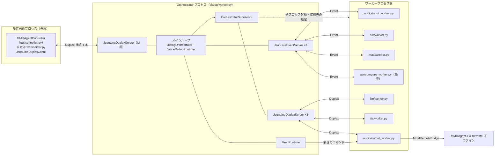
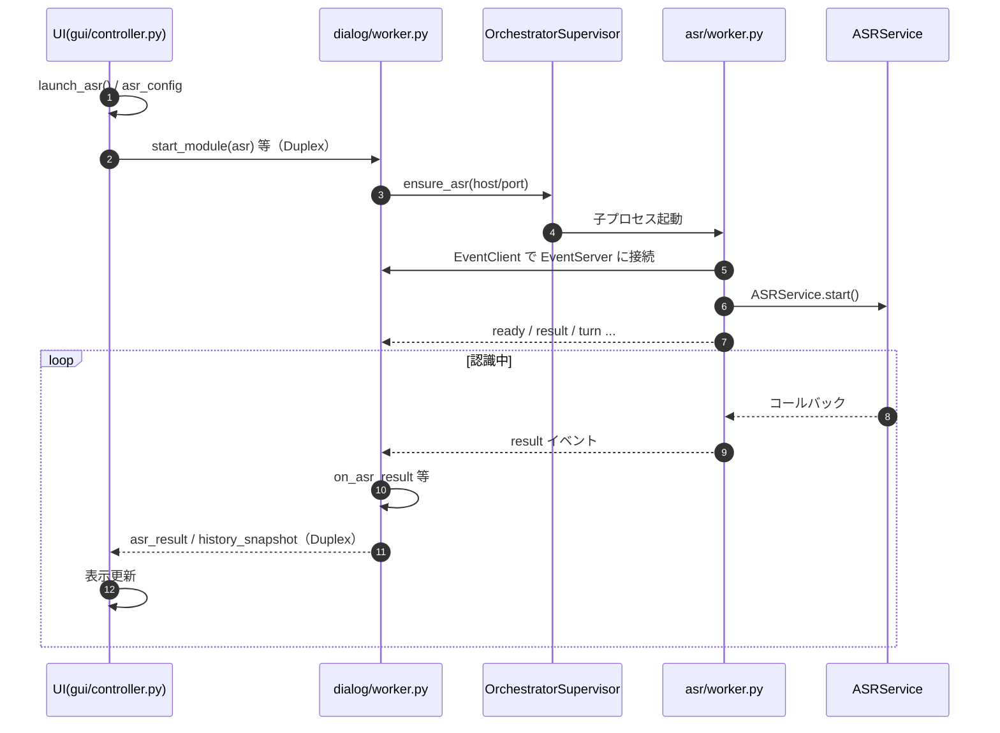
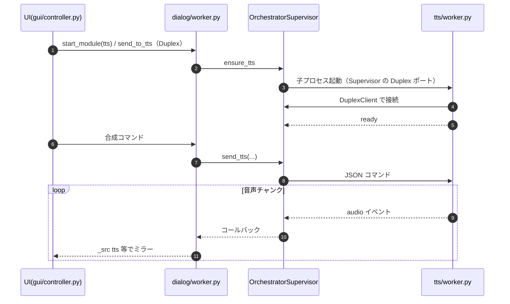
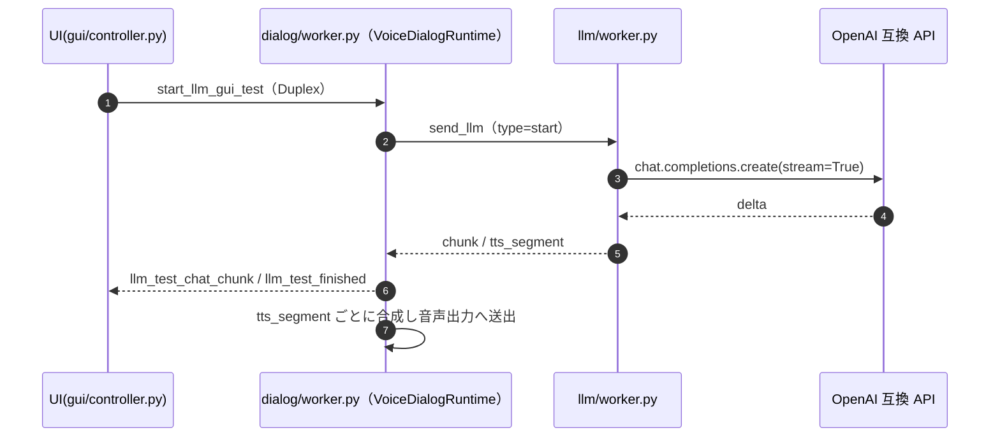
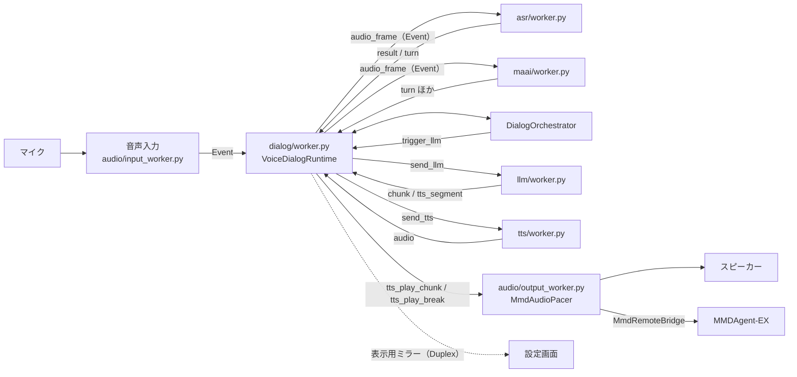

# アーキテクチャ

MaAI-SDS のプロセス構成・起動形態・プロセス間通信・音声対話のデータの流れをまとめる。各ワーカーの内部
（キュー・スレッド・VAD・エンジン別の処理）は [internals.md](./internals.md)、起動と動作確認の手順は
[running.md](./running.md) にある。

> [!NOTE]
> アプリ本体のモジュールは `src/maai_sds/` パッケージ配下にある。本書の `foo.py` という表記は
> `src/maai_sds/foo.py` を指す（`scripts/` 配下を除く）。ワーカーは `python -m maai_sds.<サブパッケージ>.<名前>`
> （例：`maai_sds.asr.worker`）で起動する。設定ファイル・`maai_assets/`・`logs/`・相対パスで指定したモデルは
> リポジトリのルートを基準に解決し、解決処理は `src/maai_sds/paths.py` に集約している。

## 1. 概要

MaAI-SDS は、設定画面（Qt アプリまたは Web UI）・対話サーバー（Orchestrator）・各処理ワーカーを別プロセスに分離した
構成をとる。IPC のハブは Orchestrator であり、設定画面はワーカーと直接通信しない。

- ASR・LLM・TTS・MaAI・音声入力・音声出力はワーカーに分離。IPC のハブは `dialog/worker.py` と、その中で動作する
  `OrchestratorSupervisor`
- 設定画面（Controller）は Orchestrator への Duplex 接続 1 本で、コマンドの送信と表示を担当
- 設定画面がなくても、Orchestrator とワーカーだけで音声対話パイプラインは動作（ヘッドレス構成）
- LLM の呼び出しは LLM ワーカー（`llm/worker.py` と `LLMService`）に一本化。設定画面の LLM テストも Orchestrator 経由
- LLM から TTS への受け渡しは Orchestrator 内の `VoiceDialogRuntime` が担当
- TTS はエンジンごとに `batch_only` / `full_streaming` の動作が混在（[internals.md](./internals.md)）
- 対話は常に Orchestrator を経由して動作。経路を切り替える設定（旧 `voice_dialog_orchestrator_enabled`）はない

主な実装ファイルは次のとおりである。

| ファイル | 役割 |
|---|---|
| `dialog/worker.py` | 対話サーバー（Orchestrator）プロセスのエントリーポイント。IPC サーバーとコマンドの振り分け |
| `dialog/runtime.py` | `VoiceDialogRuntime`。ワーカーの起動、LLM 要求の送信、TTS の分割合成と再生 |
| `dialog/orchestrator.py` | `DialogOrchestrator`。対話の状態遷移とターンテイキング |
| `dialog/settings.py` | `controller_config.json` の dict から `start_voice_dialog` のペイロードを組み立てる純関数群（GUI と CLI で共有） |
| `ipc/orchestrator_supervisor.py` | `OrchestratorSupervisor`。子ワーカーのライフサイクルと IPC |
| `ipc/jsonline.py` | JSON Lines による IPC |
| `ipc/process_service.py` | ワーカープロセスと MMDAgent-EX の起動・停止 |
| `gui/controller.py` | Qt の設定画面（`MMDAgentController`）。Orchestrator へのクライアント |
| `web/server.py` | Web UI のサーバー（FastAPI）。ブラウザと Orchestrator の間の中継 |
| `headless_main.py` | ヘッドレス CLI（`maai_sds.headless_main`） |
| `asr/worker.py`・`asr/service.py` | ASR ワーカーと `ASRService` |
| `tts/worker.py`・`tts/routing.py` | TTS ワーカーと合成・PCM の振り分け（`TtsRouter`） |
| `tts/playback_service.py` | TTS エンジンの分類、PCM のヘルパー、合成リクエストの dict の組み立て（GUI とワーカーで共有） |
| `llm/worker.py`・`llm/service.py` | LLM ワーカーと `LLMService` |

## 2. プロセス構成

| プロセス | 実体 | 役割 |
|---|---|---|
| GUI（Qt アプリ） | `main.py` | PySide6 の `QApplication` の起動と `MMDAgentController`（`gui/controller.py`）の表示 |
| Web UI | `web/server.py` | FastAPI によるブラウザと Orchestrator の間の中継 |
| ヘッドレス CLI | `headless_main.py`（`maai_sds.headless_main`） | 設定画面なしで Orchestrator を起動し、音声対話の開始・停止・各モジュールの試験を実行（[3.5](#35-ヘッドレス-cli)）。Docker の `maai-sds-headless` サービスもこれを使用 |
| Orchestrator（中核） | `dialog/worker.py` | 対話制御（`DialogOrchestrator`・`VoiceDialogRuntime`）とワーカー管理。設定画面の有無に非依存 |
| ワーカー | `asr/worker.py` など | ASR・LLM・TTS・MaAI・音声入力・音声出力の各処理 |

Orchestrator は通常、設定画面の子プロセスとして起動する。Docker の `orchestrator` サービスでは、`--listen HOST:PORT` を
指定して単独で待ち受ける。ワーカーは、Orchestrator 内の `OrchestratorSupervisor` が `ipc/process_service.py` 経由で
別の Python プロセスとして起動する。



- `OrchestratorSupervisor` は、LLM・TTS・AudioOutput の各ワーカーを自身が持つ `JsonLineDuplexServer` へ接続させる
- ASR・ASR Compare・MaAI・AudioInput の各ワーカーは、`dialog/worker.py` の `main()` が生成・待受する用途別の
  `JsonLineEventServer` へ接続するよう起動する。Supervisor は子プロセスの起動時に host / port を渡すのみで、
  これらのサーバーは持たない
- MMDAgent-EX への音声（SND）・頷きの送出は、AudioOutput ワーカー内の `MmdRemoteBridge` が担う（口パクは MMDAgent-EX が受け取った音声から生成する）。
  Orchestrator 内の `MmdRuntime` は頷きのコマンドを AudioOutput へ送る

### 2.1 対象ごとの経路

| 対象 | 経路 |
|---|---|
| IPC のハブ | `dialog/worker.py` と、その中で動作する `OrchestratorSupervisor` |
| ASR | `ensure_asr` → `asr/worker.py` → `asr/service.py`（音声と結果は Orchestrator の `JsonLineEventServer` 経由） |
| TTS（ワーカー型エンジン） | `ensure_tts` → `tts/worker.py`（Duplex サーバーは Supervisor 側） |
| TTS（VOICEVOX・TEMPLATE） | Supervisor 内の `TtsBridgeHandler` → `tts/service.py` の `TTSBridge`（HTTP） |
| LLM | `ensure_llm` → `llm/worker.py`（Duplex サーバーは Supervisor 側） |
| LLM・TTS のテスト | 設定画面から `start_llm_gui_test` / `start_tts_gui_test` を送り、Orchestrator が音声対話と同じ経路で実行 |

### 2.2 プロセスとスレッドの境界

| プロセス | 主なスレッド・構成要素 |
|---|---|
| UI（`main.py` / `gui/controller.py`） | UI メインスレッド |
| Orchestrator（`dialog/worker.py`） | メインループ + `DialogOrchestrator`、`JsonLineEventServer` ×4、`OrchestratorSupervisor`、`JsonLineDuplexServer` ×3 |
| ASR ワーカー（`asr/worker.py`） | ワーカーのメインスレッド、`ASRService` のスレッド群 |
| TTS ワーカー（`tts/worker.py`） | ワーカーのメインスレッド、TTS エンジン |
| LLM ワーカー（`llm/worker.py`） | ワーカーのメインスレッド、`LLMService` |

### 2.3 設定画面が直接管理する外部プロセス

Controller の役割は表示と操作に限られ、ワーカーとの直接の IPC は持たない。Controller が直接管理する外部プロセスは
MMDAgent-EX（`MMDProcessService`）と Qwen3-ASR のコンテナである。VOICEVOX / AivisSpeech の起動は、`send_to_tts_bridge`
を通じて対話サーバー内の `TTSBridge` が行う。

## 3. 起動形態

| 形態 | 起動方法 | Orchestrator の起動 |
|---|---|---|
| Qt アプリ | `python main.py` | Controller が子プロセスとして起動し、JSON Lines で接続 |
| Web UI | `python -m maai_sds.web.server` | Web サーバーの `OrchestratorBridge` が子プロセスとして起動 |
| Docker | `docker compose ... up` | compose のサービス内で起動（[3.4](#34-docker)） |
| ヘッドレス CLI | `python headless_main.py --config controller_config.json` | CLI が子プロセスとして起動、または起動済みのワーカーに接続 |

対話サーバーと設定画面の組み合わせ（ホスト / Docker × Qt / Web UI）と各手順は [../README.md](../README.md) と
[running.md](./running.md) にある。

### 3.1 Orchestrator の起動引数

`dialog/worker.py` は次の引数を受け付ける（いずれも任意）。

| 引数 | 内容 |
|---|---|
| `--config <path>` | Bootstrap（音声入出力ワーカーの先行起動）が読む設定ファイル。無指定なら従来どおり隣の `controller_config.json` |
| `--assume-mmd-running` | Bootstrap でも `audio_output_mode=mmd` を保つ |
| `--listen HOST:PORT`（`--listen=HOST:PORT`） | UI 用 Duplex サーバーを指定のアドレスで待ち受ける listen モード。環境変数 `MAAI_SDS_UI_LISTEN` でも指定可 |

- 通常モード：UI 用サーバーを `127.0.0.1` の空きポートで bind し、stdout に `{"ui_port": <port>}` を 1 行出力
- listen モード：`{"ui_host": ..., "ui_port": ..., "listen_mode": true}` を出力。UI が接続するたびに `ready`・`status`・
  `history_snapshot` と Supervisor の状態を送り直す（Qt の再起動による再接続に対応）。stdin の EOF では停止しない
- 通常モードでは、stdin の `stop` 行または親プロセスの終了（親 PID の監視）で停止し、子ワーカーも停止する
- 起動直後に Audio Input / Output のワーカーだけを先に起動し、MMDAgent-EX が Remote 接続できる状態にする（音声対話の開始を待たない）

### 3.2 Qt アプリ

- `main.py` が `QApplication` を起動し、`MMDAgentController` を表示
- アプリの起動時に `DialogOrchestratorProcessService` で Orchestrator を常駐起動し（引数なし）、終了時に停止
- Docker の対話サーバーへ接続する場合は、`--remote-orchestrator HOST:PORT` または環境変数
  `MAAI_SDS_REMOTE_ORCHESTRATOR` で接続先を指定し、Orchestrator を起動しない。`--dialog-server local|docker` で
  対話サーバーを選択（無指定なら GUI で最後に選んだもの）。優先順は `--remote-orchestrator` → `--dialog-server` →
  `MAAI_SDS_REMOTE_ORCHESTRATOR` → 保存した選択（`dialog_server_mode.py`）
- IPC の切断時は再接続を自動で試行

### 3.3 Web UI

- `web/server.py` の `OrchestratorBridge` が `python -u -m maai_sds.dialog.worker --config <path>` で Orchestrator を起動し、
  stdout の `ui_port` を読んで `JsonLineDuplexClient` で接続
- 受信したイベントは WebSocket（`/ws/events`）でブラウザへ中継
- Docker の対話サーバー（compose の `orchestrator`、`--listen`）につなぐ場合は、子プロセスを起動せず `remote_endpoint` へ
  接続。画面の ▶ / ■ で `docker compose up -d orchestrator` / `stop` を実行
- 待受アドレスは `MAAI_SDS_WEB_HOST`（既定 `127.0.0.1`）・`MAAI_SDS_WEB_PORT`（既定 `8000`）

### 3.4 Docker

`docker-compose.yml` の主なサービスは次のとおりである。`web` / `orchestrator` / `maai-sds-headless` はいずれも対話ワーカーを
持つため排他であり、同時に起動すると対話ワーカーが複数になり MMD bridge のポートも競合する。

| サービス | profile | 内容 | 公開ポート |
|---|---|---|---|
| `web` | （既定） | Web UI。`OrchestratorBridge` が対話ワーカーを起動 | `127.0.0.1:8000`（Web UI）、MMDAgent-EX Remote 用の `MMDAGENT_REMOTE_WS_PORT`（既定 8080）・`MMDAGENT_REMOTE_TCP_PORT`（既定 39001） |
| `orchestrator` | `qt` | `MAAI_SDS_ENTRYPOINT_MODULE=maai_sds.dialog.worker` で Orchestrator を `--listen 0.0.0.0:8765` で単独起動。Qt アプリ（`scripts\start_qt_docker.ps1`）や Web UI が接続 | `127.0.0.1:${MAAI_SDS_QT_ORCHESTRATOR_PORT:-8765}`、Remote 用のポートは `web` と同じ |
| `maai-sds-headless` | `headless` | イメージの既定の ENTRYPOINT（`python -m maai_sds.headless_main`）で `--config /app/controller_config.json --assume-mmd-running voice_dialog` を実行 | `15601`（TCP 音声出力の検証）、`39001`（MMD Remote TCP サーバー） |
| `qwen3-asr` | `qwen3` | Qwen3-ASR（vLLM） | `18000` |
| `nemotron-asr` | `nemotron` | Nemotron ASR | `19091` |
| `audiocpp` | `audiocpp` | audio.cpp のサーバー | `18081` |

- `web` と `orchestrator` の公開ポートはループバック（`127.0.0.1`）に固定（Web UI と対話サーバーには認証がないため）。
  `maai-sds-headless`・`qwen3-asr`・`nemotron-asr`・`audiocpp` はホストのすべてのアドレスに公開する
- UI 用の `JsonLineDuplexServer` は `listen(1)` で待ち受けるため、Docker の対話サーバーに同時に接続できる設定画面は 1 つ

### 3.5 ヘッドレス CLI

`dialog/worker.py` を JSON Lines プロトコルのサーバーとして起動すると、Controller GUI を起動せずに音声対話と
LLM・TTS・ASR・MaAI の各テストを実行できる。対応する構成は次の 3 通りである。

| 構成 | 起動方法 | 内容 |
|---|---|---|
| GUI なし（ヘッドレスのみ） | `python headless_main.py --config controller_config.json` | `controller_config.json` を読み込み、`dialog/settings.py` の `build_start_voice_dialog_payload(cfg)` でペイロードを作成してワーカーへ送信。SIGINT / SIGTERM を受けると `stop_voice_dialog` を送り、`status: stopped` を受信してから終了 |
| GUI あり | `python main.py` | Controller がワーカーを起動し、JSON Lines で接続 |
| GUI と外部 CLI の併用 | `headless_main.py --port <port> --no-start` | GUI が起動したワーカーのポートに、観測専用として並行して接続 |

`voice_dialog` の処理は次の順に進む。

1. `dialog/worker.py` を `python -u -m maai_sds.dialog.worker` で別プロセスとして起動（`--config`・`--assume-mmd-running` を引き継ぐ）
2. stdout の `{"ui_port": <port>}` を読み、`JsonLineDuplexClient` で接続
3. `dialog/settings.build_start_voice_dialog_payload(cfg)` で設定を変換
4. `start_voice_dialog` を送信し、`status: running` を待機
5. SIGINT / SIGTERM を受けたら `stop_voice_dialog` を送り、`status: stopped` を待って終了

```
python headless_main.py [voice_dialog | stop | status | run_llm_test | run_tts_test | run_asr_test | run_maai_test]
```

`maai-sds-headless` または `python -m maai_sds.headless_main` でも同じように実行できる。リポジトリ直下の
`headless_main.py` は、従来のコマンドとの互換性を保つためのシムである。サブコマンドを省略すると `voice_dialog` になる。

| オプション | 内容 |
|---|---|
| `--config controller_config.json` | 設定ファイルのパス |
| `--engine VOICEVOX-Core` | TTS エンジンの上書き |
| `--override key=value` | 任意のキーを JSON で上書き（複数指定可） |
| `--port <既存workerポート>` | 起動済みのワーカーに接続（ワーカーは再起動しない）。`0`（既定）なら新たに起動 |
| `--no-start` | `start_voice_dialog` を送らずに接続のみ行う（観測用） |
| `--assume-mmd-running` | MMDAgent-EX の TCP サーバーが起動済みとみなし、`audio_output_mode=mmd` を維持 |
| `--ready-timeout <秒>` | `status: running` を待つ秒数（既定 20） |
| `--input-text <文字列>` | `run_llm_test` / `run_tts_test` の入力テキスト（既定 `こんにちは`） |
| `--worker-script <path>` | Orchestrator ワーカーのスクリプトのパス |

## 4. プロセス間通信

### 4.1 JSON Lines（`ipc/jsonline.py`）

プロセス間通信は 1 本の TCP 接続上で改行区切りの JSON を送受信する方式（JSON Lines over TCP）に統一している。

| クラス | 内容 |
|---|---|
| `JsonLineDuplexServer` / `JsonLineDuplexClient` | 双方向 IPC。サーバー側は `accept` ループで接続を受け、`readline` で JSON オブジェクトを受信して `on_event(dict)` を呼ぶ。送信は `send(dict)`。切断後も listen ソケットを維持し、再接続を受け付ける |
| `JsonLineEventServer` | 着信側。クライアントから届く JSON 行を `on_event` で処理する（Audio Input / ASR / MaAI ワーカーが対話サーバーへ接続） |
| `JsonLineEventClient` | `JsonLineEventServer` への接続側。1 本の接続で双方向に通信し、`send` で `ready` や結果を上流へ送り、同じソケットの `readline` で対話サーバーからの `audio_frame` / `system_audio_frame` を受信（別ポートは使わない） |

| 区間 | サーバー | クライアント |
|---|---|---|
| Controller ↔ Orchestrator | `JsonLineDuplexServer`（`dialog/worker.py`、UI 用） | `JsonLineDuplexClient`（Controller・Web UI・ヘッドレス CLI） |
| ASR・ASR 比較・MaAI・音声入力 ↔ Orchestrator | `JsonLineEventServer`（`dialog/worker.py`） | `JsonLineEventClient`（各ワーカー） |
| LLM・TTS・音声出力 ↔ Orchestrator | `JsonLineDuplexServer`（`OrchestratorSupervisor` が保持） | `JsonLineDuplexClient`（各ワーカー） |

### 4.2 ポート

| サーバー | アドレス | 接続先の伝え方 |
|---|---|---|
| UI 用 `JsonLineDuplexServer` | `127.0.0.1` の空きポート。listen モードでは `--listen` の指定 | stdout の `{"ui_port": <port>}` |
| `JsonLineEventServer` ×4（AudioInput・ASR・ASR Compare・MaAI） | `127.0.0.1` の空きポート | Supervisor がワーカーの起動引数 `--host` / `--port` で指定 |
| Supervisor の `JsonLineDuplexServer` ×3（LLM・TTS・AudioOutput） | `127.0.0.1` の空きポート | 同上 |

Docker で公開する固定ポートは [3.4](#34-docker) の表のとおりである。

### 4.3 プロセス管理（`ipc/process_service.py`）

| クラス | 役割 |
|---|---|
| `WorkerProcessService` | ワーカー共通の基底クラス（`send_command` / `stop` / `_start_process`） |
| `MMDProcessService` | MMDAgent-EX 本体の起動・停止 |
| `ASRWorkerProcessService` ほか | ワーカーごとの `start()` 引数 |
| `DialogOrchestratorProcessService` | `dialog/worker.py` を引数なしで起動する（UI 用 Duplex サーバーはプロセス自身が起動する） |

- 起動形式：`[python, "-u", "-m", "maai_sds.<サブパッケージ>.<名前>", ...]`（例：`maai_sds.asr.worker`）。
  パス指定（`python .../asr/worker.py`）ではそのファイルが `__main__` になり、パッケージ相対の import が使えないため、
  モジュール指定で起動する
- 作業ディレクトリ：リポジトリルートに固定。パッケージ配下を作業ディレクトリにすると、`controller_config.json` の
  相対モデルパスの解決先が変わるためである
- コマンドライン引数：`--host` / `--port` / `--config-json`（TTS ワーカーは `--engine` も受け取る）
- 標準出力の排出：子プロセスは常に `stdout` / `stderr` を `PIPE` にして起動するため、`_start_process` は必ずパイプを排出する
  （`forward_console=True` ならコンソールへ転送し、それ以外は `drain_silently=True` で読み捨てる）。パイプバッファの満杯による
  子プロセスのデッドロックを防ぐためである
- `DialogOrchestratorProcessService` は、親（Controller）が `ui_port` を読み取った後も stdout を専有して読むため、
  `drain_silently=False` で起動して自動排出を無効にする

### 4.4 ワーカーの管理（`ipc/orchestrator_supervisor.py`）

`OrchestratorSupervisor` は、対話サーバープロセス内で全ワーカーのライフサイクルと、LLM / TTS / Audio Output 向けの
Duplex IPC を管理する。`dialog/worker.py` が import し、対話サーバープロセス内でインスタンス化して駆動する。

| 区分 | 内容 |
|---|---|
| Duplex ワーカー（LLM / TTS / Audio Output） | Supervisor がワーカーごとに `JsonLineDuplexServer` を起動し、ワーカーが接続する。`send_llm` / `send_tts` / `send_audio_output` で Controller からのコマンドを中継する |
| Event ワーカー（ASR / ASR Compare / MaAI / Audio Input） | ワーカーが対話サーバー側の `JsonLineEventServer` に接続し、イベントを送信する |
| モジュール単位のライフサイクル | `ensure_*` / `stop_*` / `stop_module(name)` でワーカーを個別に起動・停止する。テスト画面と音声対話で共通の API |
| ASR Compare | `ensure_asr_compare` で比較用 ASR ワーカー（`asr/compare_worker.py`）を別スロットで管理する |
| TTS ブリッジ / LLM 管理 HTTP | `handle_tts_bridge_command`（`TTSBridge`）と `handle_llm_admin_http_command`（LLM のモデル一覧取得など）を実行する |
| 切断時の動作 | IPC が予期せず切断されると、ready をクリアして `worker_disconnected` を通知（`_handle_worker_disconnect`）。次の `ensure_*` で再起動できる |

### 4.5 設定画面と Orchestrator の間のメッセージ

設定画面（Controller）から Orchestrator へのコマンド（例）：

- `start_voice_dialog` / `stop_voice_dialog`
- `update_settings` / `interrupt` / `force_finalize`
- `start_module` / `stop_module` / `send_to_llm` / `send_to_tts` / `send_to_audio_output` / `send_to_tts_bridge` / `send_to_llm_admin`
- `start_llm_gui_test` / `start_tts_gui_test`
- `tts_play_chunk` / `tts_play_break` / `mmd_audio_flush`（`audio/output_worker.py` のペーサーへ中継）
- `inject_system_audio`・`remote_plugin_apply_settings` など

Orchestrator から設定画面へのイベント（表示・ミラーの例）：

- `ready` / `status` / `log` / `stopped`
- `history_snapshot` / `latency` / `asr_result` / `turn` / `maai_result` / `raw_audio` / `inference_state`
- `trigger_llm`（LLM への送信は Orchestrator 内の `dispatch_llm_request` が実行し、Controller は主に表示を更新）
- `llm_chunk` / `llm_done` / `request_nonstream_tts` など
- `nod_motion_chart`・`audio_frame`・`remote_status` など

- `asr_result` / `turn` / `maai_result` の発生源は各ワーカーで、Orchestrator が直接受信する。Controller がこれらを中継する必要はない
- ワーカーからのイベントは、Supervisor のイベントコールバックを経て、対話サーバーが `_src` タグ（`tts`・`audio_output`・
  `llm_admin` など）を付けて Controller へ転送する
- 設定画面へ送るのは表示用のミラーイベントのみで、音声対話の制御は Orchestrator 内で完結する

Controller 以外のクライアントから対話サーバーを駆動する手順は [internals.md](./internals.md) にある。

### 4.6 シーケンス

ASR（起動から結果の表示まで）：



TTS ワーカー：



設定画面の LLM テスト：LLM テストも音声対話と同じく、Orchestrator から LLM ワーカーを経由して API を呼び出す。
TTS との連携を有効にした場合は、分割した文ごとに合成して再生経路へ送る。



## 5. 音声対話のデータの流れ

### 5.1 起動の流れ

1. Controller が `DialogOrchestratorProcessService.start(python, script)` で対話サーバーを起動
2. 対話サーバーが `JsonLineDuplexServer` を bind し、UI 用ポートを stdout に出力
3. Controller がポートを読み取り、`JsonLineDuplexClient` で接続
4. Controller が `start_voice_dialog`（`worker_configs` を含む設定）を Orchestrator へ送信
5. Orchestrator 側で `VoiceDialogRuntime.ensure_voice_dialog_workers` が `OrchestratorSupervisor` を通じて ASR・LLM・TTS・
   MaAI・音声入力・音声出力を起動し、完了後に `finalize_start_voice_dialog` から `DialogOrchestrator.start()` を実行して
   対話の状態を初期化
6. テスト画面では `start_module` コマンドでワーカーを個別に起動

停止時は Controller が `stop_voice_dialog` を送り、Orchestrator がワーカーの停止と状態のリセットを行う。

### 5.2 データフロー



1. 音声入力ワーカーの音声を Orchestrator が受け取り、ASR・MaAI へ転送（`audio_frame`）
2. ASR の結果とターン情報を Orchestrator が受け取り、`DialogOrchestrator` が条件に応じて LLM・TTS・`force_finalize` を実行
3. LLM の出力を `VoiceDialogRuntime` が TTS で合成し、音声出力ワーカー経由でスピーカーまたは MMDAgent-EX へ送出
4. 設定画面へは表示用のミラーイベントのみを送信

### 5.3 LLM から TTS・MMDAgent-EX へ

音声対話と LLM テストは、同じ経路で LLM の出力を TTS に渡す。

- LLM ワーカーが、蓄積したテキストを区切り文字で分割した `tts_segment` を Orchestrator に送信
- `VoiceDialogRuntime` がセグメントを `TtsRouter` で合成し、PCM を `tts_play_chunk` として音声出力ワーカーへ送信。
  セグメントの区切りで `tts_play_break` を送信
- 音声出力ワーカーは MMDAgent-EX へ逐次送出（`MmdAudioPacer`・`MmdRemoteBridge`）
- LLM のストリーミングと TTS の合成は `request_id` で対応付け
- MMDAgent-EX への音声（SND）は、Controller からも `tts_play_chunk` などを Orchestrator に送る経路に集約

エンジンごとのストリーミングの違いと関数単位の処理は [internals.md](./internals.md) にある。

### 5.4 ターンテイキングと MaAI

- 閾値・ストリーミング・`force_finalize` の分岐は `dialog/orchestrator.py` の `DialogOrchestrator` が担当
- ターン確率は ASR ワーカー（`smart-turn`）または MaAI ワーカー（`maai`）から Orchestrator の EventServer に届き、
  `VoiceDialogRuntime.handle_turn` を経由して `on_turn_probability` に渡される
- 頷きは Orchestrator 内の `MmdRuntime` がコマンドを作り、AudioOutput ワーカー経由で MMDAgent-EX へ送る

### 5.5 システム音声（ch2）

TTS 由来のシステム音声の経路は、音声出力ワーカーの `MmdAudioPacer` への送出や、`inject_system_audio` の Duplex
コマンドなど、設定と出力モードに依存する。詳細は [internals.md](./internals.md) にある。

## 6. 設定

- アプリ全体の設定：`controller_config.json`（`config_store.py`）
- 永続化するキーの定義：平坦なフィールドは `gui/app_config_spec.py` の宣言テーブル、それ以外は `gui/config_io.py` の
  `_collect_app_config_payload`（`llm_model_lmstudio`・`llm_model_openai` など）。廃止したキーは読み込み対象外
- 設定から `start_voice_dialog` のペイロードへの変換は `dialog/settings.py`（GUI とヘッドレス CLI で共有）

## 7. 関連文書

| 文書 | 内容 |
|---|---|
| [../README.md](../README.md) | 概要・セットアップ・起動 |
| [internals.md](./internals.md) | 対話制御と各ワーカーの内部実装 |
| [running.md](./running.md) | 起動と動作確認の手順（Qt・Web UI・Docker） |
| [asr-engine-notes.md](./asr-engine-notes.md) | ASR エンジンの実測値と既定値の根拠 |
| [sherpa-onnx-custom-build.md](./sherpa-onnx-custom-build.md) | sherpa-onnx のパッチとビルド |
| [ui-guidelines.md](./ui-guidelines.md) | UI の設計方針と用語 |
| [../THIRD_PARTY_NOTICES.md](../THIRD_PARTY_NOTICES.md) | 第三者のソフトウェアとモデルのライセンス |
